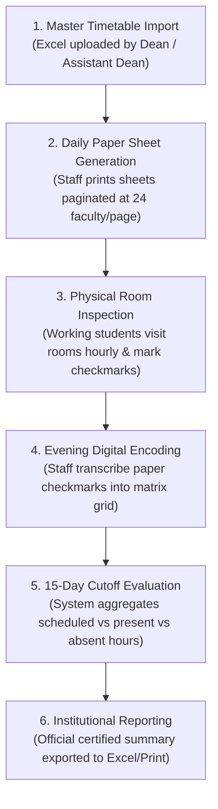
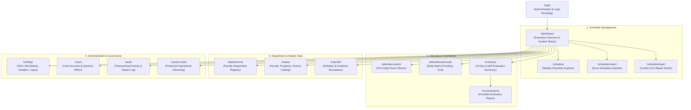
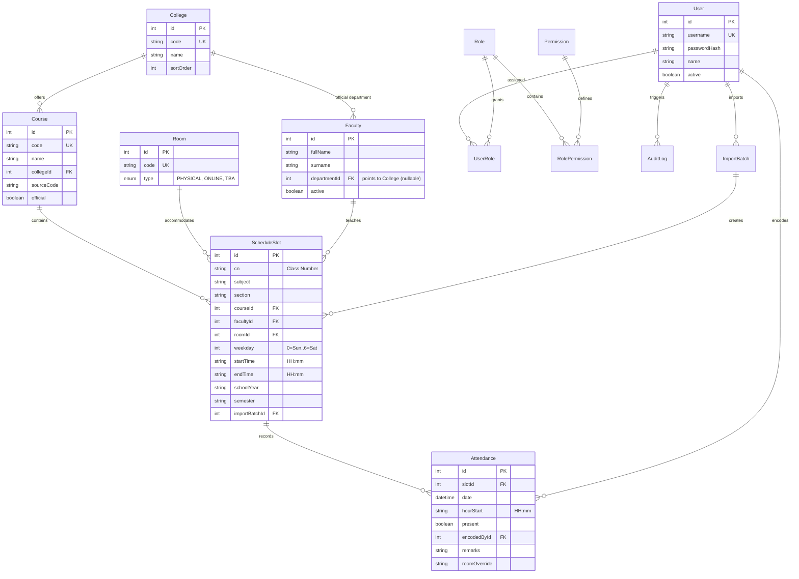
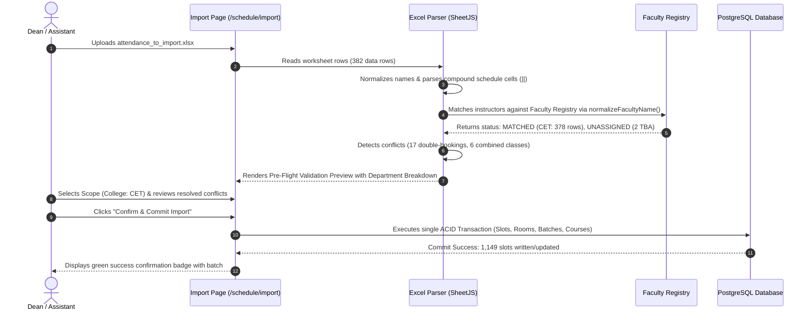
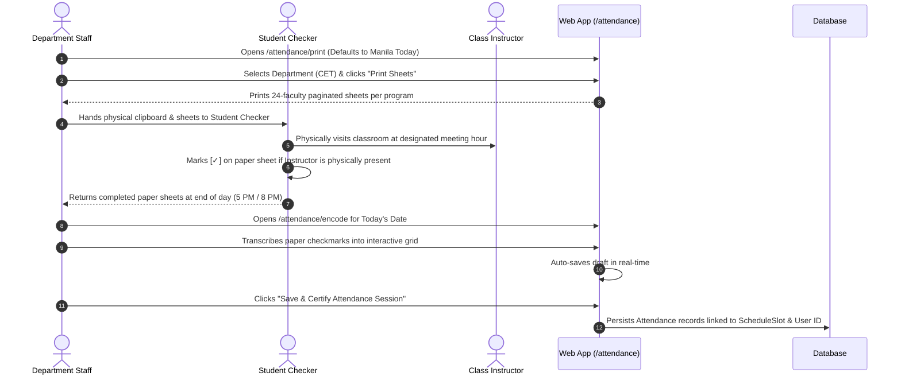

# FACULTY ATTENDANCE AND TIME LOG SYSTEM — COMPREHENSIVE BLUEPRINT & WIREFRAME SPECIFICATION

> **Client:** Ramon Magsaysay Memorial Colleges, Inc. (RMMC) — College of Engineering and Technology (CET)  
> **Campus:** Pioneer Avenue, General Santos City, South Cotabato, Philippines  
> **Technology Stack:** Next.js 16 (App Router, Turbopack, React 19), TypeScript, Tailwind CSS, Prisma ORM, PostgreSQL  
> **Document Purpose:** Single, self-contained master specification containing the complete system architecture, business rules, ASCII wireframes for all 16 pages, entity-relationship diagrams, and operational user workflows.

---

## TABLE OF CONTENTS

1. [Executive Summary & Real-World Flow](#1-executive-summary--real-world-flow)
2. [User Personas & Role-Based Access Control (RBAC)](#2-user-personas--role-based-access-control-rbac)
3. [Master Schedule Data & Deterministic Parser Specifications](#3-master-schedule-data--deterministic-parser-specifications)
4. [Master Faculty Department Registry (CET Roster Specifications)](#4-master-faculty-department-registry-cet-roster-specifications)
5. [Information Architecture & Site Map](#5-information-architecture--site-map)
6. [Global Application Shell Wireframe](#6-global-application-shell-wireframe)
7. [Page-by-Page ASCII Wireframes & Component Hierarchies](#7-page-by-page-ascii-wireframes--component-hierarchies)
   - 7.1 [Authentication Screen (`/login`)](#71-authentication-screen-login)
   - 7.2 [Force Change Password (`/change-password`)](#72-force-change-password-change-password)
   - 7.3 [Executive Dashboard (`/dashboard`)](#73-executive-dashboard-dashboard)
   - 7.4 [Weekly Schedule Explorer (`/schedule`)](#74-weekly-schedule-explorer-schedule)
   - 7.5 [Schedule Excel Importer (`/schedule/import`)](#75-schedule-excel-importer-scheduleimport)
   - 7.6 [AI & Conflict Schedule Repair Studio (`/schedule/repair`)](#76-ai--conflict-schedule-repair-studio-schedulerepair)
   - 7.7 [Faculty Department Membership Registry (`/departments`)](#77-faculty-department-membership-registry-departments)
   - 7.8 [Master Institutional Data Management (`/master`)](#78-master-institutional-data-management-master)
   - 7.9 [Attendance Daily Encoding Matrix Station (`/attendance/encode`)](#79-attendance-daily-encoding-matrix-station-attendanceencode)
   - 7.10 [Official Attendance Sheet Generator & Print Studio (`/attendance/print`)](#710-official-attendance-sheet-generator--print-studio-attendanceprint)
   - 7.11 [Faculty Evaluation Attendance Summary (`/summary`)](#711-faculty-evaluation-attendance-summary-summary)
   - 7.12 [Printable Summary Report View (`/summary/print`)](#712-printable-summary-report-view-summaryprint)
   - 7.13 [Academic Calendar & Holiday Management (`/calendar`)](#713-academic-calendar--holiday-management-calendar)
   - 7.14 [Institutional Settings & Branding Studio (`/settings`)](#714-institutional-settings--branding-studio-settings)
   - 7.15 [User Accounts & RBAC Roles (`/users`)](#715-user-accounts--rbac-roles-users)
   - 7.16 [System Activity & Security Audit Log (`/audit`)](#716-system-activity--security-audit-log-audit)
   - 7.17 [Protected Operational System Reset (`/system-reset`)](#717-protected-operational-system-reset-system-reset)
8. [Entity-Relationship Data Model & Database Schema](#8-entity-relationship-data-model--database-schema)
9. [Operational User Journey Flowcharts](#9-operational-user-journey-flowcharts)
10. [Design System Tokens & Component Catalog](#10-design-system-tokens--component-catalog)

---

## 1. EXECUTIVE SUMMARY & REAL-WORLD FLOW

The **Faculty Attendance and Time Log System** is a mission-critical web application designed for academic administration at RMMC College of Engineering and Technology. The system replaces fragmented paper logs with a deterministic, verified attendance recording workflow.

### 1.1 The Real-World Operational Lifecycle



1. **Schedule Import:** The department manages semester class schedules across academic programs (BSIT, BSCS, BSCE-SE, BLIS, ACT, etc.). The Dean or Assistant Dean imports an Excel workbook (`attendance_to_import.xlsx`). The system parses compound slots, selects physical rooms over virtual links, identifies faculty departments deterministically, and isolates conflicts.
2. **Daily Print Generation:** Each morning, staff generate and print daily attendance sheets for selected programs. The system defaults to the current date in `Asia/Manila` time.
3. **Physical Inspection (Offline Student Checkers):** Working students carry printed clipboards across campus buildings (`AVR`, `EMM`, `FGM`, `AGM`, `COM Lab`). For each scheduled hour, they physically verify the instructor's presence and tick `[✓]`. No mark denotes an absence.
4. **Digital Encoding:** At the end of the day (5:00 PM / 8:00 PM), department staff encode the paper checkmarks into the web system via a high-density, real-time matrix grid with auto-save drafts.
5. **Cutoff Evaluation:** Every 15 days (the institutional evaluation cutoff), the system aggregates scheduled hours, rendered hours, late minutes, and absences per faculty member.
6. **Important Scope Boundary:** **Salary/payroll is NOT computed by this system.** The system outputs certified attendance summaries used exclusively for faculty evaluation and academic compliance.

---

## 2. USER PERSONAS & ROLE-BASED ACCESS CONTROL (RBAC)

The system enforces dynamic Role-Based Access Control (RBAC) via the database.

| User Persona | System Login? | Primary Responsibilities | Key Permissions Granted |
|---|---|---|---|
| **Dean** | Yes | Full system governance, user administration, final schedule approval, institutional branding, system reset. | `all permissions`, `faculty.manage`, `system.reset`, `user.manage` |
| **Assistant Dean** | Yes | Master schedule imports, timetable repair, curriculum program mapping, faculty department registry management. | `schedule.import`, `schedule.edit`, `faculty.manage`, `attendance.view` |
| **Department Staff** | Yes | Daily sheet generation/printing, daily attendance encoding, 15-day cutoff evaluation summaries, holiday logs. | `attendance.print`, `attendance.encode`, `attendance.summary`, `faculty.view` |
| **Working Students** | **No Login** | Physical room-to-room inspection, paper sheet markups, returning sheets to the office. | None (Works exclusively on physical paper sheets) |

---

## 3. MASTER SCHEDULE DATA & DETERMINISTIC PARSER SPECIFICATIONS

### 3.1 Excel Source File Structure (`attendance_to_import.xlsx`)

- **Worksheet Name:** `Sheet1`
- **Columns (12 Exact Headers):** `Term Type`, `Subject`, `CN`, `Description`, `Unit`, `Sem`, `Schedule`, `Section`, `Course`, `Slots`, `Instructor`, `Code`

| Column | Meaning | Example Data | System Handling |
|---|---|---|---|
| `Term Type` | Term period indicator (`1`, `2`) | `1` | Informational only; does not filter printed days. |
| `Subject` | Subject code | `GE501`, `IT101` | Mapped directly to schedule slot. |
| `CN` | Class Number (Unique offering ID) | `44017` | Unique meeting key component. |
| `Description`| Full subject title | `Science, Tech, & Society` | Preserved for display and print sheets. |
| `Unit` | Academic credit units | `3` | Converted to integer units. |
| `Sem` | Source semester text | `1st Semester` | Normalized to active period. |
| `Schedule` | Compound schedule string | `F/M/T/Th/W 10:00 AM-11:00 AVR \|\| OLC \|\| ASYNC` | Parsed via multi-modal selection algorithm. |
| `Section` | Section identifier | `IT1_S1B12627` | Displayed on print and timetable. |
| `Course` | Program code (not subject) | `BSIT`, `BSCS`, `BSCE-SE` | Course program identifier. |
| `Slots` | Enrollment ratio | `47/45` | Informational capacity indicator. |
| `Instructor`| Instructor name string | `Claver, Priscilla De Leon` | Normalized for roster resolution. |
| `Code` | Student year level | `1st`, `2nd`, `3rd`, `4th` | Student curriculum level. |

### 3.2 Compound Schedule Cell (`||`) Resolution Algorithm

A single Excel schedule cell frequently lists 3 delivery modes separated by ` || `:
```text
F/M/T/Th/W 10:00 AM-11:00 AVR || F/M/T/Th/W 10:00 AM-11:00 OLC || F/M/T/Th/W 10:00 AM-11:00 ASYNC
```

1. **Split & Clean:** Split cell by `||` and trim whitespace.
2. **Grouping by Day & Clock Interval:** Group items by `(sorted weekdays, start_time, end_time)`.
3. **Room Hierarchy:**
   - If a **physical classroom** is present (`AVR`, `FGM512`, `EMM201`, `COM B`), select it as the meeting room (`mode = FACE_TO_FACE`).
   - Else if `OLC` is present, room is `OLC` (`mode = ONLINE`).
   - Else if `TBA` is present, room is `TBA` (`mode = FACE_TO_FACE` with write-in line on paper).
   - `ASYNC` is **never** printed as a room.
4. **Lab Suffix Handling:** Suffixes like `(Lab)` or `AGM102 (CE LAB)` are stripped for room lookup, setting `mode = LAB`.
5. **Meeting Deduplication:** Same-time alternatives collapse into **one scheduled meeting hour**, preventing duplicate class entries.

---

## 4. MASTER FACULTY DEPARTMENT REGISTRY (CET ROSTER SPECIFICATIONS)

### 4.1 Strict Independence Rule

> **A faculty member's department is a permanent roster fact (`Faculty.departmentId`). It is NEVER inferred from student course codes, subject names, or teaching assignments.**

- A **CET faculty member** teaching General Education (`GE501`) or NSTP to non-CET students remains a **CET member**.
- A **CBE faculty member** teaching an IT minor subject to BSIT students remains a **CBE member** and is excluded from CET sheets.
- An unassigned faculty member remains in manual review until an authorized administrator explicitly assigns a department.

### 4.2 Name Normalization Algorithm

```typescript
export function normalizeFacultyName(name: string | null | undefined): string {
  return String(name ?? "")
    .normalize("NFKC")
    .trim()
    .replace(/[\u2018\u2019\u02bc]/g, "'")
    .replace(/[.,]/g, "")
    .replace(/\s+/g, " ")
    .toUpperCase();
}
```

### 4.3 Initial CET Master Roster (105 Verified Members)

All 105 CET members are persisted with `departmentId: 1` (`CET`) in PostgreSQL:
1. `Abueme, Kimberly Kate` *(Confirmed CET faculty assignment)*
2. Plus the 104 verified CET candidates identified from the attendance roster:
   *Aban, Marianita; Abdurajik, Basiren; Alarcio, Daniel Jade; Alib, Alan; Alupit, Baby Jane; Amboy, Fryon Gil; Arriza, Rolando; Atienza, Jurielhyn; Ayunan, Aaron; Bachicha, Hubert Von; Bantilan, Rudelyn; Barasan, Gary; Barrientos, Angelo; Bayoran, Kris Anjiela; Buhat, Alvin; Busangilan, Clinth; Callaga, Jaypee; Camiller, Elesio III; Capada, Joseph; Castaño, Ereckjun; Castro, Aldrin; Casumpang, Von Bryan; Ceralde, Julius; Cimagala, Jodel; Claver, Priscilla; Colas, Rosery; Crujedo, Raize Grace; Cueme, Mariton; Dela Fuente, Christine; Dijan, Corazon; Enriquez, Charwin; Espartero, Joy Mae; Espinosa, Lester John; Esquillo, Honey Loyd; Fajartin, Christian Jay; Farnazo, Gay Marie; Ferolino, Wendy Rejin; Gamboa, Desiree; Genton, Emie; Gracia, John Lloyd; Gusto, Sylvester; Hechanova, Khyla; Jamero, Jim; Jorolan, Kit; Juevesa, Roel; Kainage, Arnesto; Lacanilao, Edward; Lagahit, Mary Cris; Langomez, Jerric; Lino, Ernest Jay; Liquit, Jazer; Lorente, Bianca Marie; Macaway, Garlan; Mahaling, Joseph; Maizo, Francis Thyrone; Manalo, Aletheia; Melicio, Janette; Moral, Gem Eden Louiza; Mortiga, Arlon; Moscoso, Maria Ysabella; Musca, Diyls Anthea; Nalaunan, Lani; Narciso, Jessie John; Nosotros, Anthony Bryll; Ocon, Rosel Grace; Oczon, Ethel; Orang, Renante; Orias, Emelyn; Ortiz, Althea; Pabitay, Aljhon Rhae; Padua, Jollivie; Palacios, Joshua; Palmes, Mark Lehi; Pascual, Aubrey; Projo, Rodney; Rañises, Marlon; Reburcio, Gerald Ryan; Rendaje, Irene; Repalbor, Mike Virnel; Reyes, Gemma; Rivas, Pauline Enrhel; Rocacurva, Salome; Rojas, Rey Mart; Ruales, Gregorio; Salabao, Ana Fe; Saligumba, Marisol; Salubre, Jestler; Salvaloza, Sean Davvin; San Luis, Rudyric; Siga, Ham; Silah, Steven; Silao, D. J. Brylle; Siose, Beniffer; Tabal, Mage Belle; Tan, John Michael; Tangub, Billy Dale; Tongcua, April Joy; Torres, Dave; Valenzon, Angelita; Vallestero, Kevin Clint; Vargas, Vince Evan; Villacura, Nelly Abegail; Viray, Clark Alonzo; Yambing, Primrose.*

---

## 5. INFORMATION ARCHITECTURE & SITE MAP



---

## 6. GLOBAL APPLICATION SHELL WIREFRAME

```text
+-----------------------------------------------------------------------------------------------------------------------+
|  [RMMC LOGO] [CET LOGO]  COLLEGE OF ENGINEERING AND TECHNOLOGY                     Term: 2026-2027 · 1st Semester     |
|                          Faculty Attendance & Time Log System                      Time: Mon, Nov 12, 2026 (Manila)   |
|                                                                                    [Dean User (Admin) ▼] [Logout]     |
+----------------------+------------------------------------------------------------------------------------------------+
| MAIN NAVIGATION      | BREADCRUMBS: Dashboard > Attendance > Daily Encoding Matrix                                   |
|                      +------------------------------------------------------------------------------------------------+
|  [Dashboard]         | PAGE TITLE & ACTION CONTROLS                                                                   |
|                      |                                                                                                |
|  SCHEDULE            |                                                                                                |
|  - Weekly Schedule   |                                                                                                |
|  - Import Schedule   |                                                                                                |
|  - AI Repair Studio  |                                                                                                |
|                      |                                                                                                |
|  ATTENDANCE          |                                                                                                |
|  - Print Daily Sheet |                                                                                                |
|  - Daily Encoding    |                                       MAIN CONTENT VIEWPORT                                    |
|  - Evaluation Summary|                                                                                                |
|                      |                                                                                                |
|  INSTITUTIONAL       |                                                                                                |
|  - Departments       |                                                                                                |
|  - Master Data       |                                                                                                |
|  - Academic Calendar |                                                                                                |
|                      |                                                                                                |
|  ADMINISTRATION      |                                                                                                |
|  - Settings & Logos  |                                                                                                |
|  - User Accounts     |                                                                                                |
|  - Security Audit    |                                                                                                |
|  - System Reset      |                                                                                                |
+----------------------+------------------------------------------------------------------------------------------------+
| v2.0 · RMMC CET      | SYSTEM HEALTH: PostgreSQL 18 Online | Port 5432 | Active Term: Verified | Manila Timezone (GMT+8)     |
+----------------------+------------------------------------------------------------------------------------------------+
```

---

## 7. PAGE-BY-PAGE ASCII WIREFRAMES & COMPONENT HIERARCHIES

### 7.1 Authentication Screen (`/login`)

```text
+-----------------------------------------------------------------------------+
|                                                                             |
|                                [ RMMC LOGO ]                                |
|                   RAMON MAGSAYSAY MEMORIAL COLLEGES, INC.                   |
|                    COLLEGE OF ENGINEERING AND TECHNOLOGY                    |
|                         Pioneer Avenue, General Santos City                 |
|                                                                             |
|                    +------------------------------------+                   |
|                    | FACULTY ATTENDANCE & TIME LOG      |                   |
|                    | Authorized Staff & Faculty Sign-In |                   |
|                    +------------------------------------+                   |
|                    | Username:                          |                   |
|                    | [ admin                          ] |                   |
|                    |                                    |                   |
|                    | Password:                          |                   |
|                    | [ •••••••••••••••••              ] |                   |
|                    |                                    |                   |
|                    | [X] Remember active term           |                   |
|                    |                                    |                   |
|                    | [       Sign In to Dashboard     ] |                   |
|                    |                                    |                   |
|                    | [!] Invalid credentials banner     |                   |
|                    +------------------------------------+                   |
|                                                                             |
|        Designed for CET Academic Administration · Working Student Supported  |
|                                                                             |
+-----------------------------------------------------------------------------+
```

---

### 7.2 Force Change Password (`/change-password`)

```text
+-----------------------------------------------------------------------------+
|                     SECURITY NOTICE: INITIAL PASSWORD RESET                 |
+-----------------------------------------------------------------------------+
|  You are required to change your temporary password before accessing the   |
|  system. Choose a strong password with at least 8 characters.               |
|                                                                             |
|  Current Password:                                                          |
|  [ •••••••••••••••••                                                      ] |
|                                                                             |
|  New Password:                                                              |
|  [ •••••••••••••••••                                                      ] |
|                                                                             |
|  Confirm New Password:                                                      |
|  [ •••••••••••••••••                                                      ] |
|                                                                             |
|  [ Update Password & Continue ]                         [ Cancel & Sign Out ]
+-----------------------------------------------------------------------------+
```

---

### 7.3 Executive Dashboard (`/dashboard`)

```text
+-----------------------------------------------------------------------------------------------------------------------+
| Dashboard                                                                                   Academic Term: 2026-2027  |
| System Overview & Daily Operational Readiness                                               Semester: 1st Semester    |
+-----------------------------------------------------------------------------------------------------------------------+
|  +-------------------+  +-------------------+  +-------------------+  +-------------------+  +---------------------+  |
|  | REGISTERED FACULTY|  | CET CORE FACULTY  |  | OFFICIAL PROGRAMS |  | ACTIVE ROOMS      |  | TODAY'S CLASSES     |  |
|  |       311         |  |       105         |  |        41         |  |        38         |  |         142         |  |
|  | 206 unassigned    |  | 100% verified     |  | 5 CET, 36 others  |  | 32 Phys, 5 Lab, 1 |  | Thursday Schedule |  |
|  +-------------------+  +-------------------+  +-------------------+  +-------------------+  +---------------------+  |
+-----------------------------------------------------------------------------------------------------------------------+
| QUICK ACTIONS:                                                                                                        |
|  [ + Import Class Schedule ]    [ 🖶 Print Daily Sheets ]    [ ✎ Daily Attendance Encoding ]   [ 📊 15-Day Summary ]   |
+-----------------------------------------------------------------------------------------------------------------------+
| RECENT AUDIT ACTIVITY (Live Log Stream)                                                                               |
| +---------------------+-----------------------+------------------------------------------------+--------------------+ |
| | Timestamp           | Actor                 | Action Category                                | Impact Summary     | |
| +---------------------+-----------------------+------------------------------------------------+--------------------+ |
| | 2026-11-12 14:25    | Dean (dean)           | faculty.department.roster                      | Assigned 104 CET   | |
| | 2026-11-11 18:45    | Assistant Dean (asst) | schedule.import.commit                         | Batch #14: 1,149 sl| |
| | 2026-11-10 17:30    | Staff Encoder (staff) | attendance.session.save                        | BSIT Day 42 saved  | |
| +---------------------+-----------------------+------------------------------------------------+--------------------+ |
| [ View Complete Audit Log (2,410 events) -> ]                                                                         |
+-----------------------------------------------------------------------------------------------------------------------+
```

---

### 7.4 Weekly Schedule Explorer (`/schedule`)

```text
+-----------------------------------------------------------------------------------------------------------------------+
| Weekly Master Schedule Explorer                                            [ Export Schedule ]  [ + Import Schedule ] |
+-----------------------------------------------------------------------------------------------------------------------+
| FILTERS:                                                                                                              |
| Department: [ CET (College of Engineering and Technology) ▼ ]  Program: [ BSIT ▼ ]  Year: [ All ▼ ]  Room: [ All ▼ ]  |
| Instructor: [ All Instructors ▼ ]                              Mode:    [ All Modes ▼ ]     Search: [ Search CN/Subj] |
+-----------------------------------------------------------------------------------------------------------------------+
| VIEW MODE: [ (•) Weekly Time Grid ]  [ ( ) Detailed List Table ]                                                       |
+--------+-------------------+-------------------+-------------------+-------------------+-------------------+----------+
| TIME   | MON               | TUE               | WED               | THU               | FRI               | SAT      |
+--------+-------------------+-------------------+-------------------+-------------------+-------------------+----------+
| 07:00  | [IT101 - FGM512 ] |                   | [IT101 - FGM512 ] |                   | [IT101 - FGM512 ] |          |
| 08:00  | CN: 48132 (BSIT)  |                   | CN: 48132 (BSIT)  |                   | CN: 48132 (BSIT)  |          |
|        | Espinosa, L.      |                   | Espinosa, L.      |                   | Espinosa, L.      |          |
+--------+-------------------+-------------------+-------------------+-------------------+-------------------+----------+
| 08:00  | [GE501 - AVR    ] | [CS201 - COM B  ] | [GE501 - AVR    ] | [CS201 - COM B  ] | [GE501 - AVR    ] |          |
| 09:00  | CN: 48005 (BSIT)  | CN: 47011 (BSCS)  | CN: 48005 (BSIT)  | CN: 47011 (BSCS)  | CN: 48005 (BSIT)  |          |
|        | Saligumba, M.     | Jamero, J.        | Saligumba, M.     | Jamero, J.        | Saligumba, M.     |          |
+--------+-------------------+-------------------+-------------------+-------------------+-------------------+----------+
```

---

### 7.5 Schedule Excel Importer (`/schedule/import`)

```text
+-----------------------------------------------------------------------------------------------------------------------+
| Import Master Class Schedule (.xlsx)                                                                                  |
| Upload official semester schedule. Supports compound slots, physical room selection & cross-department faculty.       |
+-----------------------------------------------------------------------------------------------------------------------+
| 1. ACADEMIC TARGET TERM & FILE SELECTION                                                                              |
| School Year: [ 2026-2027 ▼ ]   Semester: [ 1st Semester ▼ ]   Coverage: 2026-08-15 to 2026-12-20 (Verified)           |
|                                                                                                                       |
| + - - - - - - - - - - - - - - - - - - - - - - - - - - - - - - - - - - - - - - - - - - - - - - - - - - - - - - - - - + |
| |                    Drag and drop attendance_to_import.xlsx here or [ Browse Computer ]                           | |
| |                    Selected: attendance_to_import.xlsx (142.5 KB) · 382 rows detected                            | |
| + - - - - - - - - - - - - - - - - - - - - - - - - - - - - - - - - - - - - - - - - - - - - - - - - - - - - - - - - - + |
| [ Generate Validation Preview ]                                                                                       |
+-----------------------------------------------------------------------------------------------------------------------+
| 2. DEPARTMENT CLASSIFICATION BREAKDOWN (Strictly by Faculty Member's Registered Department)                           |
| +-------------------+  +-------------------+  +-------------------+  +-------------------+  +---------------------+   |
| | CET FACULTY ROWS  |  | CBE FACULTY ROWS  |  | CTE FACULTY ROWS  |  | COAHS FACULTY     |  | UNASSIGNED / TBA    |   |
| |       378         |  |        0          |  |        0          |  |        0          |  |        2            |   |
| | 104 distinct fac. |  | 0 distinct fac.   |  | 0 distinct fac.   |  | 0 distinct fac.   |  | CN 42008, 48115     |   |
| +-------------------+  +-------------------+  +-------------------+  +-------------------+  +---------------------+   |
| Instructor Review Breakdown: 0 Unassigned in Roster · 0 Unmatched · 0 Ambiguous Duplicate Matches                      |
+-----------------------------------------------------------------------------------------------------------------------+
| 3. RECONCILIATION SUMMARY & CONFLICT ANALYSIS                                                                         |
| Total Rows: 382 | Parsed: 379 | Errored: 3 (Rows 277, 336, 354) | Planned Slots: 1,149 | Room Conflicts: 17           |
|                                                                                                                       |
| [!] SCHEDULE CONFLICTS DETECTED (Genuine Double-Bookings):                                                            |
|  - Claver, Priscilla: CN 42000 (LIS101) & CN 42011 (LIS111) overlap Friday 10:00-11:00 AM                             |
|  - Saligumba, Marisol: CN 48005 (GE501) & CN 48007 (GE401) overlap Monday 08:00-09:00 AM                              |
+-----------------------------------------------------------------------------------------------------------------------+
| 4. IMPORT SCOPE & REPROCESS CONTROLS                                                                                  |
| College Scope: [ CET — College of Engineering and Technology ▼ ]  Program Scope: [ All Programs in Scope ▼ ]          |
|                                                                                                                       |
| [X] Reprocess existing slots only                                                                                     |
|     (Updates faculty associations and rooms without inserting new slots or deleting attendance history)              |
|                                                                                                                       |
| Scope Summary: CET · 5 programs · 378 rows · 1,139 slots · 1,139 changes to write                                    |
|                                                                                                                       |
| [  ✓ Confirm & Commit Import  ]   [ Cancel & Discard ]                                                                |
+-----------------------------------------------------------------------------------------------------------------------+
```

---

### 7.6 AI & Conflict Schedule Repair Studio (`/schedule/repair`)

```text
+-----------------------------------------------------------------------------------------------------------------------+
| Schedule AI & Conflict Repair Studio                                                                                  |
| Inspect conflicting room allocations, compound slot anomalies, and suggest non-destructive scheduling adjustments.     |
+-----------------------------------------------------------------------------------------------------------------------+
| DATA QUALITY METRICS:                                                                                                 |
| [ Overall Quality Score: 94.2% ]  17 Double-Bookings  |  6 Combined Sections  |  134 TBA Rooms  |  3 Parse Anomalies  |
+-----------------------------------------------------------------------------------------------------------------------+
| DETECTED ISSUE #1: Genuine Double-Booking on Faculty Member                                                           |
| Faculty: Saligumba, Marisol Facto | Day: Monday | Time: 08:00 AM - 09:00 AM                                           |
|                                                                                                                       |
| Slot A: CN 48005 · GE501 (STS) · Section IT1_S1B · Room AVR                                                           |
| Slot B: CN 48007 · GE401 (Ethics) · Section CS1_A · Room FGM512                                                       |
|                                                                                                                       |
| AI / Rule Diagnosis: Instructor scheduled in two physical classrooms simultaneously.                                  |
| Recommended Resolution:                                                                                               |
|  (•) Move Slot B to Tuesday 08:00 AM - 09:00 AM in FGM512 (Room & Faculty Free)                                       |
|  ( ) Designate Slot B as Combined/Online OLC session                                                                  |
|  ( ) Leave as flagged conflict and notify department secretary                                                        |
|                                                                                                                       |
| [ Apply Resolution ]   [ Skip Finding ]                                                                               |
+-----------------------------------------------------------------------------------------------------------------------+
| DETECTED ISSUE #2: TBA Classroom Placeholder Allocation                                                               |
| CN 48132 · BSIT · Section IT3_A · Instructor: Espinosa, Lester John · Monday 07:00-09:00 AM · Room: TBA               |
| Candidate Physical Classrooms Available:                                                                              |
|  [ FGM406 (Cap: 45) ▼ ]   [ Assign Room & Resolve TBA ]                                                               |
+-----------------------------------------------------------------------------------------------------------------------+
```

---

### 7.7 Faculty Department Membership Registry (`/departments`)

```text
+-----------------------------------------------------------------------------------------------------------------------+
| Faculty Department Membership Registry                                                        [ + Master Data ]       |
| Department membership is a permanent roster fact independent of subject codes or student programs.                    |
+-----------------------------------------------------------------------------------------------------------------------+
|  +-------------------+  +-------------------+  +-------------------+  +---------------------+                         |
|  | REGISTERED FACULTY|  | CET MEMBERS       |  | UNASSIGNED        |  | HISTORICAL RECORDS  |                         |
|  |       311         |  |       105         |  |       206         |  |       14,820        |                         |
|  | All active staff  |  | 104 seed + 1 conf |  | Pending review    |  | Slots + Attendances |                         |
|  +-------------------+  +-------------------+  +-------------------+  +---------------------+                         |
+-----------------------------------------------------------------------------------------------------------------------+
| ADD / ASSIGN FACULTY TO DEPARTMENT (Dean / Assistant Dean Authorization)                                               |
| Filter by Name: [ cruz                      ]  Select Faculty: [ Dela Cruz, Juan P. (Unassigned) ▼ ]                  |
| Target Department: [ CET — College of Engineering and Technology ▼ ]   [ Assign to Department ]                        |
+-----------------------------------------------------------------------------------------------------------------------+
| DEPARTMENT FILTER TABS:                                                                                               |
| [ All Faculty (311) ] [ Unassigned (206) ] [ *CET (105)* ] [ CBE (0) ] [ CTE (0) ] [ COAHS (0) ]                      |
|                                                                                                                       |
| Search Faculty: [ Search instructor name...                     ]                                                     |
+-----------------------------------+--------------------+--------------------+-------+------------+--------------------+
| Faculty Name                      | Department         | Membership Status  | Slots | Attendance | Actions            |
+-----------------------------------+--------------------+--------------------+-------+------------+--------------------+
| Abueme, Kimberly Kate             | CET — Engineering  | [ Member of CET  ] |   12  |    144     | [ CET ▼ ] [Set]    |
|                                   |                    |                    |       |            | [Remove from Dept] |
+-----------------------------------+--------------------+--------------------+-------+------------+--------------------+
| Alarcio, Daniel Jade Hibune       | CET — Engineering  | [ Member of CET  ] |   18  |    216     | [ CET ▼ ] [Set]    |
|                                   |                    |                    |       |            | [Remove from Dept] |
+-----------------------------------+--------------------+--------------------+-------+------------+--------------------+
| Unassigned Faculty Example        | No Department      | [  Unassigned    ] |    6  |      0     | [ CET ▼ ] [Set]    |
+-----------------------------------+--------------------+--------------------+-------+------------+--------------------+
```

---

### 7.8 Master Institutional Data Management (`/master`)

```text
+-----------------------------------------------------------------------------------------------------------------------+
| Master Institutional Data Directory                                                                                   |
+-----------------------------------------------------------------------------------------------------------------------+
| TABS: [ (•) Faculty Members (311) ]   [ ( ) Academic Programs (41) ]   [ ( ) Classrooms & Labs (38) ]                 |
+-----------------------------------------------------------------------------------------------------------------------+
| CREATE NEW FACULTY MEMBER:                                                                                            |
| Full Name: [ Surname, Given Middle         ]  Department: [ CET ▼ ]  [ Save Faculty ]                                 |
+-----------------------------------------------------------------------------------------------------------------------+
| REGISTERED FACULTY ROSTER                                                       Search: [ Search name...            ] |
+------+-----------------------------------+--------------------+---------+----------------------+----------------------+
| ID   | Full Name                         | Surname            | Active? | Department           | Action               |
+------+-----------------------------------+--------------------+---------+----------------------+----------------------+
| 107  | Claver, Priscilla De Leon         | Claver             | [X] Yes | CET — Engineering    | [Edit] [Deactivate]  |
| 108  | Narciso, Jessie John Saligue      | Narciso            | [X] Yes | CET — Engineering    | [Edit] [Deactivate]  |
| 109  | Espinosa, Lester John             | Espinosa           | [X] Yes | CET — Engineering    | [Edit] [Deactivate]  |
| 215  | Santos, Maria Business            | Santos             | [X] Yes | CBE — Business       | [Edit] [Deactivate]  |
+------+-----------------------------------+--------------------+---------+----------------------+----------------------+
```

---

### 7.9 Attendance Daily Encoding Matrix Station (`/attendance/encode`)

```text
+-----------------------------------------------------------------------------------------------------------------------+
| Daily Attendance Encoding Matrix                                                    [ Save Attendance Session ]       |
| Record checkmarks from paper sheets into the digital registry.                      Status: All drafts saved (14:32)  |
+-----------------------------------------------------------------------------------------------------------------------+
| DATE & SCOPE SELECTOR:                                                                                                |
| Date: [ 2026-11-12 ] (Today · Asia/Manila)   Department: [ CET ▼ ]   Program: [ BSIT ▼ ]   School Year: [ 2026-2027 ] |
| Coverage Check: ✓ Date is within Academic Semester bounds (2026-08-15 to 2026-12-20)                                  |
+-----------------------------------------------------------------------------------------------------------------------+
| STATUS LEGEND:  [✓] Present (Green)  [✗] Absent (Red)  [⏱] Late (Amber)  [E] Excused (Blue)  [—] No Class / Blank     |
+-------------+---------------------+---------------------+---------------------+---------------------+-----------------+
| TIME HOUR   | Claver, Priscilla   | Espinosa, Lester    | Narciso, Jessie     | Saligumba, Marisol  | Siose, Beniffer |
|             | LIS / Programming   | Networking / Web    | Databases / LIS     | General Education   | Engineering     |
+-------------+---------------------+---------------------+---------------------+---------------------+-----------------+
| 07:00-08:00 | [ — No Class      ] | [ ✓ Present · FGM ] | [ — No Class      ] | [ — No Class      ] | [ ✓ Present   ] |
+-------------+---------------------+---------------------+---------------------+---------------------+-----------------+
| 08:00-09:00 | [ — No Class      ] | [ ✓ Present · FGM ] | [ — No Class      ] | [ ✗ Absent · AVR  ] | [ ✓ Present   ] |
+-------------+---------------------+---------------------+---------------------+---------------------+-----------------+
| 09:00-10:00 | [ ⏱ Late (15m)   ] | [ — No Class      ] | [ ✓ Present · EMM ] | [ — No Class      ] | [ — No Class  ] |
+-------------+---------------------+---------------------+---------------------+---------------------+-----------------+
| 10:00-11:00 | [ ✓ Present · AVR ] | [ — No Class      ] | [ ✓ Present · EMM ] | [ — No Class      ] | [ — No Class  ] |
+-------------+---------------------+---------------------+---------------------+---------------------+-----------------+
| 11:00-12:00 | [ — No Class      ] | [ — No Class      ] | [ — No Class      ] | [ — No Class      ] | [ — No Class  ] |
+-------------+---------------------+---------------------+---------------------+---------------------+-----------------+
| SUMMARY     | 2h Present, 1h Late | 2h Present          | 2h Present          | 1h Absent           | 2h Present      |
+-------------+---------------------+---------------------+---------------------+---------------------+-----------------+
| Session Notes / Remarks: [ Room AVR audio issue reported by student checker.                                        ] |
| [ Submit Daily Attendance & Certify Session ]                                                                         |
+-----------------------------------------------------------------------------------------------------------------------+
```

---

### 7.10 Official Attendance Sheet Generator & Print Studio (`/attendance/print`)

```text
+-----------------------------------------------------------------------------------------------------------------------+
| Official Attendance Sheet Generator & Print Studio                                         [ 🖶 Print Generated Pages ]|
+-----------------------------------------------------------------------------------------------------------------------+
| GENERATION PARAMETERS:                                                                                                |
| Date Mode:  (•) Single Day   ( ) Date Range (Cutoff)                                                                  |
| Start Date: [ 2026-11-12 ] (Asia/Manila Today)      End Date: [ 2026-11-12 ]     Max Bound: 31 days                   |
| Department: [ CET (College of Engineering and Technology) ▼ ]                    Term: [ 2026-2027 1st Sem ▼ ]        |
| Programs Included: [X] BSIT   [X] BSCS   [X] BSCE-SE   [X] BLIS   [X] ACT                                             |
| Pagination Rule: Fixed 24 faculty columns per printable sheet (Data-level guaranteed)                                 |
+-----------------------------------------------------------------------------------------------------------------------+
| PRINT PREVIEW (Page 1 of 3 · Program: BSIT · Date: Thursday, November 12, 2026)                                       |
| +-------------------------------------------------------------------------------------------------------------------+ |
| |                                     RAMON MAGSAYSAY MEMORIAL COLLEGES, INC.                                       | |
| |                                      COLLEGE OF ENGINEERING AND TECHNOLOGY                                        | |
| |                                     DAILY FACULTY ROOM & ATTENDANCE LOG SHEET                                     | |
| | Date: November 12, 2026 (Thursday)               Program: BSIT                       Semester: 1st Semester 26-27 | |
| +-------------+-------------------+-------------------+-------------------+-------------------+-----------------+ |
| | TIME        | ESPINOSA, L.      | CLAVER, P.        | SALIGUMBA, M.     | NARCISO, J.       | [ Checker Tick] | |
| |             | FGM512 (IT101)    | AVR (IT202)       | FGM406 (GE501)    | EMM201 (IT301)    |                 | |
| +-------------+-------------------+-------------------+-------------------+-------------------+-----------------+ |
| | 07:00-08:00 | [   ] Rm: FGM512  |                   |                   |                   | [  ] Verified   | |
| | 08:00-09:00 | [   ] Rm: FGM512  |                   | [   ] Rm: FGM406  |                   | [  ] Verified   | |
| | 09:00-10:00 |                   | [   ] Rm: AVR     |                   | [   ] Rm: EMM201  | [  ] Verified   | |
| | 10:00-11:00 |                   | [   ] Rm: AVR     |                   | [   ] Rm: EMM201  | [  ] Verified   | |
| +-------------+-------------------+-------------------+-------------------+-------------------+-----------------+ |
| | Checked & Inspected By: ___________________________       Certified Correct: ___________________________          | |
| | Student Checker / Room Inspector                          Dean / Assistant Dean                                   | |
| +-------------------------------------------------------------------------------------------------------------------+ |
+-----------------------------------------------------------------------------------------------------------------------+
```

---

### 7.11 Faculty Evaluation Attendance Summary (`/summary`)

```text
+-----------------------------------------------------------------------------------------------------------------------+
| Faculty Evaluation Attendance Summary                                  [ 🖶 Print Summary ]  [ 📥 Export to Excel ]    |
| 15-Day Cutoff attendance computation for faculty performance evaluation. (Salary is NOT computed).                    |
+-----------------------------------------------------------------------------------------------------------------------+
| CUTOFF FILTER CRITERIA:                                                                                               |
| Cutoff Range: [ 2026-11-01 ] to [ 2026-11-15 ] (15 Days)   Department: [ CET ▼ ]   Program: [ All Programs ▼ ]        |
| Filter Faculty: [ All Faculty in CET ▼ ]                    Sort By: [ Absences (High to Low) ▼ ]                     |
+-----------------------------------------------------------------------------------------------------------------------+
| EVALUATION SUMMARY TABLE                                                                                              |
+-----------------------------+------------+-----------------+-----------------+----------------+-----------------------+
| Faculty Full Name           | Department | Scheduled Hours | Present Hours   | Absent Hours   | Late / Tardy (Hours)  |
+-----------------------------+------------+-----------------+-----------------+----------------+-----------------------+
| Claver, Priscilla De Leon   | CET        |      54.0       |      52.0       |      2.0       |       1.5 hrs (2x)    |
| Espinosa, Lester John       | CET        |      60.0       |      60.0       |      0.0       |       0.0 hrs (0x)    |
| Narciso, Jessie John S.     | CET        |      45.0       |      45.0       |      0.0       |       0.5 hrs (1x)    |
| Saligumba, Marisol Facto    | CET        |      30.0       |      26.0       |      4.0       |       0.0 hrs (0x)    |
| Siose, Beniffer             | CET        |      48.0       |      48.0       |      0.0       |       0.0 hrs (0x)    |
+-----------------------------+------------+-----------------+-----------------+----------------+-----------------------+
| TOTALS                      | CET Core   |     237.0 hrs   |     231.0 hrs   |      6.0 hrs   |       2.0 hrs         |
+-----------------------------+------------+-----------------+-----------------+----------------+-----------------------+
```

---

### 7.12 Printable Summary Report View (`/summary/print`)

```text
+-----------------------------------------------------------------------------------------------------------------------+
|                                        RAMON MAGSAYSAY MEMORIAL COLLEGES, INC.                                        |
|                                         COLLEGE OF ENGINEERING AND TECHNOLOGY                                         |
|                                             FACULTY ATTENDANCE EVALUATION REPORT                                      |
|                                       Cutoff Coverage: November 1, 2026 - November 15, 2026                           |
+-----------------------------------------------------------------------------------------------------------------------+
| Department: College of Engineering and Technology              Academic Year: 2026-2027 · 1st Semester                |
+-----------------------------+------------+-----------------+-----------------+----------------+-----------------------+
| Faculty Member Name         | Department | Scheduled Hours | Rendered Hours  | Absent Hours   | Late / Tardy Hours    |
+-----------------------------+------------+-----------------+-----------------+----------------+-----------------------+
| Claver, Priscilla De Leon   | CET        |      54.0       |      52.0       |      2.0       |        1.5 hrs        |
| Espinosa, Lester John       | CET        |      60.0       |      60.0       |      0.0       |        0.0 hrs        |
| Narciso, Jessie John S.     | CET        |      45.0       |      45.0       |      0.0       |        0.5 hrs        |
| Saligumba, Marisol Facto    | CET        |      30.0       |      26.0       |      4.0       |        0.0 hrs        |
+-----------------------------+------------+-----------------+-----------------+----------------+-----------------------+
| Prepared By: __________________________                       Certified Correct: __________________________           |
| Staff In-Charge                                               Dean, College of Engineering & Technology               |
+-----------------------------------------------------------------------------------------------------------------------+
```

---

### 7.13 Academic Calendar & Holiday Management (`/calendar`)

```text
+-----------------------------------------------------------------------------------------------------------------------+
| Academic Calendar & Holiday Schedule                                                   [ + Declare Holiday/Suspension]|
+-----------------------------------------------------------------------------------------------------------------------+
| NOVEMBER 2026                                                                   Legend: [H] Holiday  [S] Suspension   |
+-------------+-------------+-------------+-------------+-------------+-------------+-------------+                     |
| SUN         | MON         | TUE         | WED         | THU         | FRI         | SAT         |                     |
+-------------+-------------+-------------+-------------+-------------+-------------+-------------+                     |
| 1 [H] AllSnt| 2           | 3           | 4           | 5           | 6           | 7           |                     |
| 8           | 9           | 10          | 11          | 12 (Today)  | 13          | 14          |                     |
| 15          | 16          | 17          | 18          | 19          | 20          | 21          |                     |
| 22          | 23          | 24          | 25          | 26          | 27          | 28          |                     |
| 29          | 30 [H] Boni |             |             |             |             |             |                     |
+-------------+-------------+-------------+-------------+-------------+-------------+-------------+                     |
| LISTED HOLIDAYS IN ACTIVE TERM:                                                                                       |
|  - Nov 1, 2026: All Saints' Day (Special Non-Working Holiday)                                                         |
|  - Nov 30, 2026: Bonifacio Day (Regular Holiday)                                                                      |
+-----------------------------------------------------------------------------------------------------------------------+
```

---

### 7.14 Institutional Settings & Branding Studio (`/settings`)

```text
+-----------------------------------------------------------------------------------------------------------------------+
| Institutional Settings & Configuration                                                [ Save Configuration Changes ]  |
+-----------------------------------------------------------------------------------------------------------------------+
| 1. ACTIVE ACADEMIC PERIOD & DATE BOUNDARIES                                                                           |
| Active School Year: [ 2026-2027          ]   Active Semester: [ 1st Semester ▼ ]                                      |
| Semester Coverage Start: [ 2026-08-15    ]   Semester Coverage End: [ 2026-12-20    ]                                 |
| [!] Dates strictly gate attendance sheet generation and prevent encoding outside valid calendar ranges.               |
+-----------------------------------------------------------------------------------------------------------------------+
| 2. PRINTED SHEET INSTITUTIONAL HEADERS                                                                                |
| School Header:                                                                                                        |
| [ RAMON MAGSAYSAY MEMORIAL COLLEGES, INC.                                                                           ] |
| College / Department Header:                                                                                          |
| [ COLLEGE OF ENGINEERING AND TECHNOLOGY                                                                             ] |
| Campus Address / Subtitle:                                                                                            |
| [ Pioneer Avenue, General Santos City, South Cotabato, Philippines                                                  ] |
+-----------------------------------------------------------------------------------------------------------------------+
| 3. REPORT SIGNATORIES & CERTIFICATIONS                                                                                |
| Prepared By (Default Staff / Checker Title):                                                                          |
| Name: [ JUAN DELA CRUZ               ]   Title: [ Working Student Supervisor                                        ] |
| Checked & Verified By (Dean Title):                                                                                   |
| Name: [ ENGR. CET DEAN, PECE, M.Eng  ]   Title: [ Dean, College of Engineering and Technology                       ] |
+-----------------------------------------------------------------------------------------------------------------------+
| 4. INSTITUTIONAL EMBLEMS & SEALS                                                                                      |
| School Seal (Left Header Logo):            College Emblem (Right Header Logo):                                        |
| +----------------------+                   +----------------------+                                                   |
| |  [ RMMC LOGO PREV ]  | [ Upload Logo ]   |  [ CET EMBLEM PREV ] | [ Upload Emblem ]                                 |
| +----------------------+                   +----------------------+                                                   |
+-----------------------------------------------------------------------------------------------------------------------+
```

---

### 7.15 User Accounts & RBAC Roles (`/users`)

```text
+-----------------------------------------------------------------------------------------------------------------------+
| User Account & Access Control (RBAC)                                                   [ + Create New User Account ]  |
+-----------------------------------------------------------------------------------------------------------------------+
| SYSTEM USERS DIRECTORY                                                          Search: [ Search user name...       ] |
+----+-----------------------+----------------------+--------------------+----------+----------------+------------------+
| ID | Username              | Full Name            | Assigned Role(s)   | Status   | Must Change PW | Actions          |
+----+-----------------------+----------------------+--------------------+----------+----------------+------------------+
| 1  | dean                  | Engr. CET Dean       | Dean (SuperAdmin)  | [Active] | [ ] No         | [Edit] [Reset PW]|
| 2  | assistant.dean        | Asst. Dean Officer   | Assistant Dean     | [Active] | [ ] No         | [Edit] [Reset PW]|
| 3  | staff.encoder         | Juan Dela Cruz       | Staff Encoder      | [Active] | [ ] No         | [Edit] [Reset PW]|
| 4  | new.employee          | Maria Santos         | Staff Encoder      | [Active] | [X] Yes        | [Edit] [Reset PW]|
+----+-----------------------+----------------------+--------------------+----------+----------------+------------------+
| ROLE PERMISSION MATRIX OVERVIEW:                                                                                      |
|  - Dean: Full System Access, Reset Operational Data, User Creation, Department Membership Allocation                  |
|  - Assistant Dean: Master Schedule Uploads, Schedule Repair, Curriculum Mapping, Faculty Registry Management          |
|  - Staff Encoder: Daily Attendance Encoding, Daily Sheet Print Generation, Cutoff Attendance Summary Evaluation       |
+-----------------------------------------------------------------------------------------------------------------------+
```

---

### 7.16 System Activity & Security Audit Log (`/audit`)

```text
+-----------------------------------------------------------------------------------------------------------------------+
| System Activity & Security Audit Trail                                                 [ 📥 Export Audit Log to CSV ] |
| Immutable, transaction-level audit records capturing every administrative action and preserved record count.          |
+-----------------------------------------------------------------------------------------------------------------------+
| AUDIT LOG FILTERS:                                                                                                    |
| Action Category: [ All Actions ▼ ]   Actor: [ All Users ▼ ]   Date: [ 2026-11-01 ] to [ 2026-11-12 ]                  |
+-----------------------------------------------------------------------------------------------------------------------+
| AUDIT LOG ENTRIES STREAM                                                                                              |
+---------------------+-----------------------+----------------------------------+--------------------------------------+
| Timestamp (Manila)  | User Actor            | Action Type                      | Action Detail & Historical Impact    |
+---------------------+-----------------------+----------------------------------+--------------------------------------+
| 2026-11-12 14:25:40 | dean (Engr. CET Dean) | faculty.department.roster        | Assigned 104 initial CET candidates. |
| 2026-11-11 18:45:15 | assistant.dean        | schedule.import.commit           | Batch #14: 1,149 slots written.      |
| 2026-11-10 17:30:12 | staff.encoder         | attendance.session.save          | Certified attendance for BSIT Nov 10.|
| 2026-11-08 09:15:30 | dean                  | faculty.department               | Updated Abueme, K.: 12 slots presrvd.|
+---------------------+-----------------------+----------------------------------+--------------------------------------+
```

---

### 7.17 Protected Operational System Reset (`/system-reset`)

```text
+-----------------------------------------------------------------------------------------------------------------------+
| Operational Data Reset & Sanitization Studio                                                                          |
| High-caution administrative tool to flush test attendance and temporary schedules without harming master data.       |
+-----------------------------------------------------------------------------------------------------------------------+
| [!] CRITICAL WARNING: OPERATIONAL CLEANSING ONLY                                                                      |
| Performing a reset wipes transient timetable slots and attendance checkmarks.                                         |
| Master Faculty records, Department Registries, Programs, Rooms, User Accounts, and Audit Logs are 100% PRESERVED.     |
+-----------------------------------------------------------------------------------------------------------------------+
| IMPACT AUDIT MATRIX:                                                                                                  |
| DATA TO BE DELETED (Flushed):                    DATA TO BE PRESERVED (Permanent):                                    |
|  - Encoded Attendance Records: 14,210             - Master Faculty Registry: 311 faculty members (105 CET)            |
|  - Attendance Daily Sessions: 180                 - College & Department Registry: 6 Colleges                         |
|  - Schedule Class Slots: 1,149                    - Course Catalog: 41 official academic programs                     |
|  - Excel Import Batches: 14                       - Physical Classrooms & Labs: 38 rooms                              |
|  - AI Repair Findings: 23                         - System User Accounts & Roles: 6 users                             |
|                                                   - Security Audit Logs: 2,410 log entries                            |
+-----------------------------------------------------------------------------------------------------------------------+
| CONFIRMATION GUARD:                                                                                                   |
| Type the exact confirmation phrase below to unlock the reset action:                                                  |
| Type: RESET OPERATIONAL DATA                                                                                          |
| [ RESET OPERATIONAL DATA                                                             ]                                |
|                                                                                                                       |
| [ ⚠ Flush Operational Data (Irreversible) ]   [ Cancel & Return to Safety ]                                          |
+-----------------------------------------------------------------------------------------------------------------------+
```

---

## 8. ENTITY-RELATIONSHIP DATA MODEL & DATABASE SCHEMA



---

## 9. OPERATIONAL USER JOURNEY FLOWCHARTS

### 9.1 Schedule Import & Conflict Reconciliation



---

### 9.2 Daily Paper Sheet Printing, Room Inspection & Encoding



---

## 10. DESIGN SYSTEM TOKENS & COMPONENT CATALOG

| Token Category | Tailwind Utility / Hex Code | Usage Scenario |
|---|---|---|
| **Primary Brand Navy** | `#1e3a8a` / `text-navy`, `bg-navy` | Main headers, active tabs, primary navigation, institutional titles |
| **Canvas Background** | `#f8fafc` / `bg-slate-50` | Page background, card header accents, inactive rows |
| **Card Surface** | `#ffffff` / `bg-white` | Content containers, modal dialogs, data table cards |
| **Line & Border** | `#e2e8f0` / `border-line` | Form field borders, table grid cell dividers, card borders |
| **Ink Text Primary** | `#0f172a` / `text-ink` | Headings, faculty names, primary data values |
| **Muted Text** | `#64748b` / `text-muted` | Subtitles, field descriptions, column notes, audit timestamps |
| **Success Tone** | `#15803d` / `bg-green-100 text-green-800` | Present attendance badges, official programs, valid imports |
| **Warning / Amber** | `#b45309` / `bg-amber-100 text-amber-800` | Unassigned faculty, tardy/late attendance, combined classes |
| **Danger / Red** | `#b91c1c` / `bg-red-100 text-red-800` | Absent attendance, double-booking conflicts, system reset button |

---

### End of Blueprint Specification
*(File generated: `SYSTEM_BLUEPRINT_AND_WIREFRAMES.md` · RMMC CET Faculty Attendance & Time Log System)*
