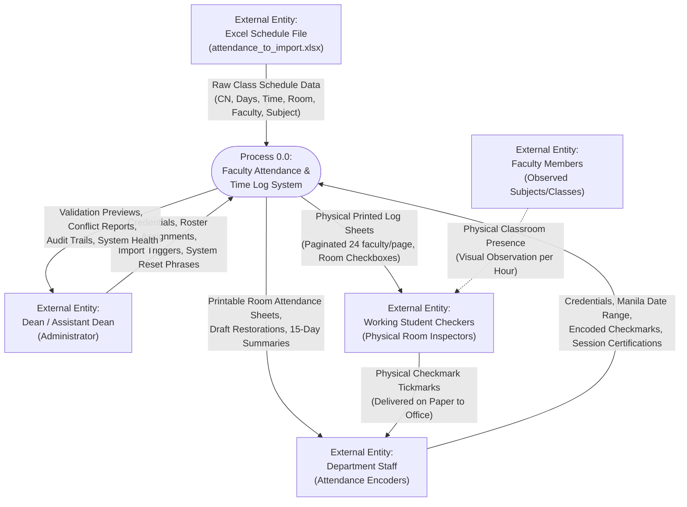
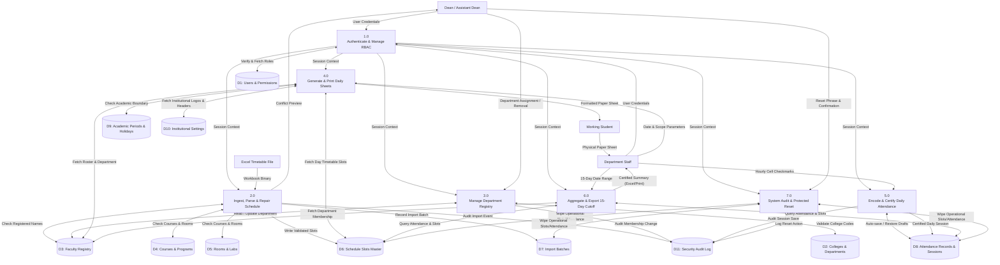
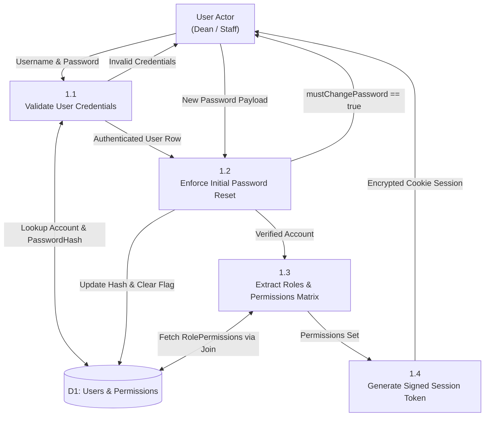
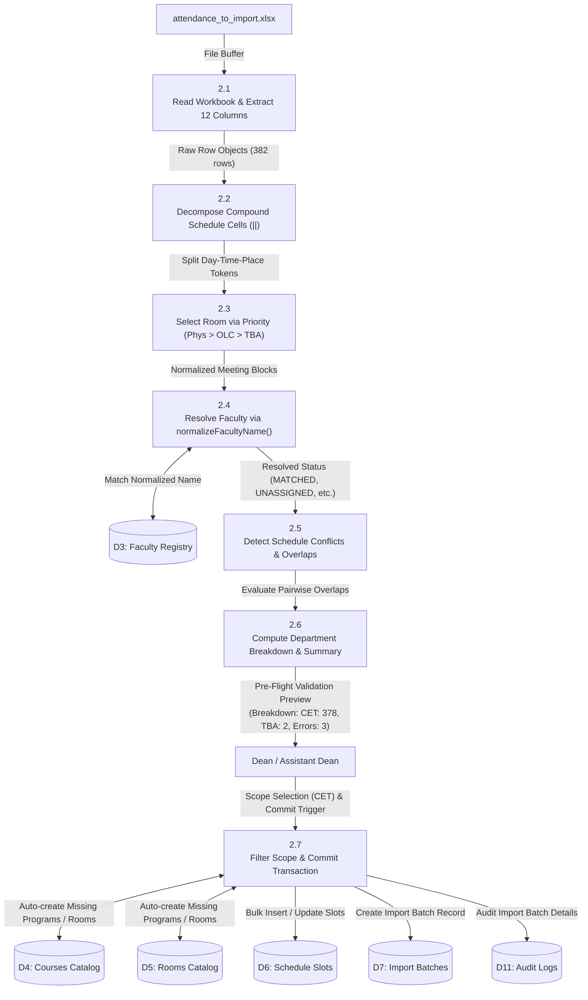
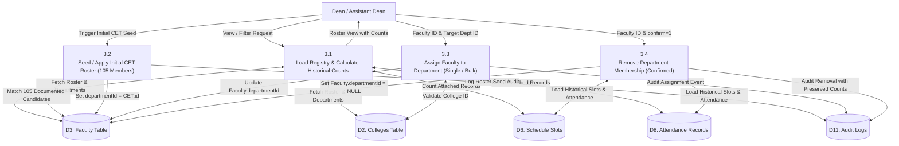
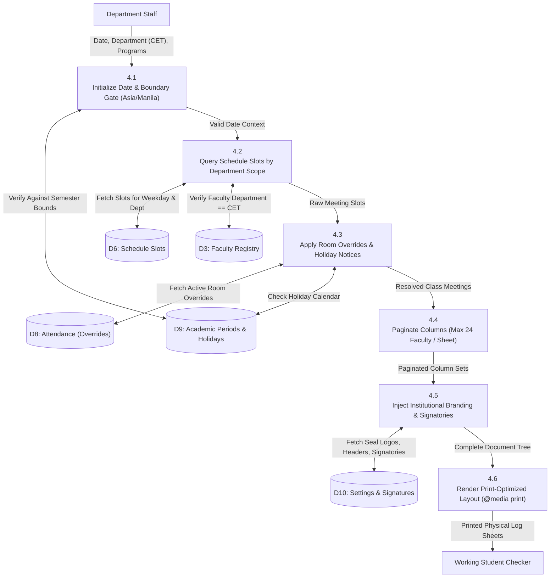
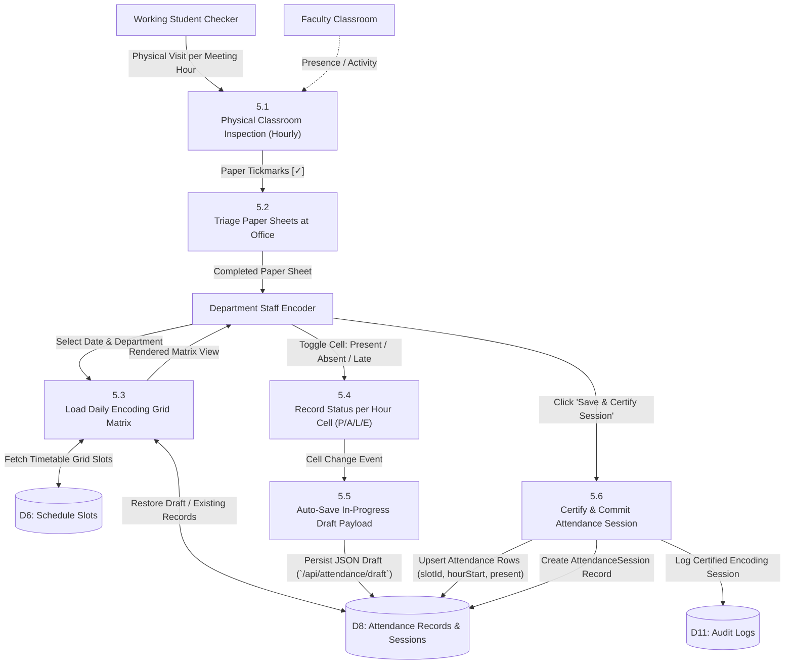
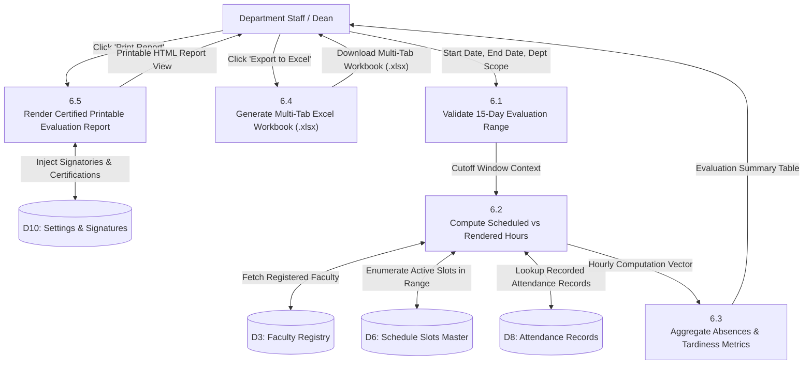
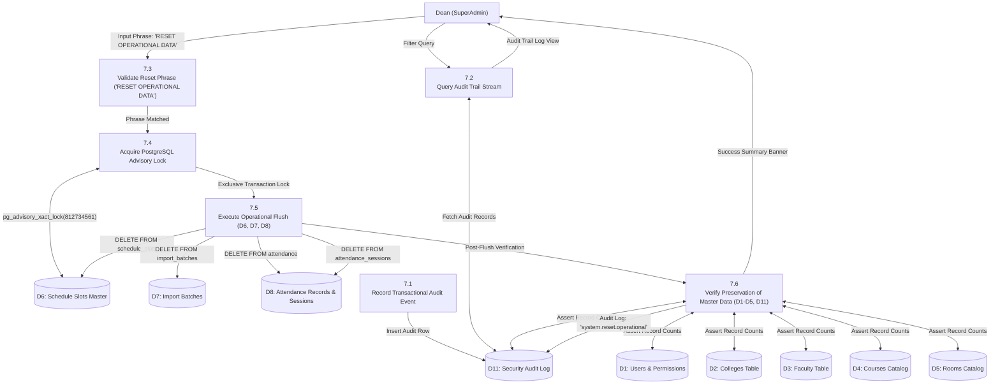

# FACULTY ATTENDANCE AND TIME LOG SYSTEM — DATA FLOW DIAGRAM (DFD) SPECIFICATION

> **Institution:** Ramon Magsaysay Memorial Colleges, Inc. (RMMC)  
> **Unit:** College of Engineering and Technology (CET), Pioneer Avenue, General Santos City  
> **System:** Faculty Attendance and Time Log System  
> **Document Purpose:** Comprehensive, detailed Data Flow Diagram (DFD) specification from Context Level (Level 0) down to functional decomposition (Level 1 & Level 2), complete with a comprehensive Data Dictionary, Process Specifications, and Data Store Definitions.

---

## TABLE OF CONTENTS

1. [DFD Conventions & Notation](#1-dfd-conventions--notation)
2. [Level 0: System Context Diagram](#2-level-0-system-context-diagram)
   - 2.1 Context Diagram Architecture
   - 2.2 External Entities Inventory
   - 2.3 Boundary Input and Output Data Flows
3. [Level 1: System Decomposition DFD](#3-level-1-system-decomposition-dfd)
   - 3.1 Subsystem Process Architecture
   - 3.2 Master Data Stores Inventory
   - 3.3 Inter-Process Data Routing
4. [Level 2: Detailed Process Decompositions](#4-level-2-detailed-process-decompositions)
   - 4.1 Process 1.0: User Authentication & Access Control (RBAC)
   - 4.2 Process 2.0: Schedule Ingestion, Parsing & Conflict Analysis
   - 4.3 Process 3.0: Department Registry & Faculty Membership Management
   - 4.4 Process 4.0: Daily Attendance Sheet Generation & Print Dispatch
   - 4.5 Process 5.0: Physical Room Inspection & Daily Digital Encoding
   - 4.6 Process 6.0: 15-Day Cutoff Attendance Aggregation & Reporting
   - 4.7 Process 7.0: System Governance, Security Auditing & Operational Reset
5. [Comprehensive Data Dictionary](#5-comprehensive-data-dictionary)
   - 5.1 Data Flow Definitions
   - 5.2 Data Store Structures (Physical Schema Alignment)
   - 5.3 Process Specifications (Mini-Specs / P-Specs)
6. [Traceability & Architectural Constraints](#6-traceability--architectural-constraints)

---

## 1. DFD CONVENTIONS & NOTATION

This specification employs the **Gane and Sarson / Yourdon-DeMarco hybrid notation** represented natively via standard Mermaid diagrams and structured data dictionaries:

```text
┌───────────────────────┐         (  Process ID  )         ╔══════════════════════╗
│    External Entity    │   ───►  (   Process    )   ───►  ║ D# |   Data Store    ║
│ [Source / Sink Agent] │  [Flow] (Transformation)         ╚══════════════════════╝
└───────────────────────┘
```

- **External Entities (Rectangles):** People, departments, or external hardware/files outside system boundary (Dean, Assistant Dean, Staff Encoders, Working Students, Faculty, Source Excel File).
- **Processes (Circles / Rounded Rectangles):** Logic transforming incoming data flows into outgoing data flows (Numbered hierarchically: `0.0`, `1.0`, `1.1`, `2.1.1`).
- **Data Stores (Open Double Rectangles / Parallel Lines):** Persistent database tables in PostgreSQL.
- **Data Flows (Arrows with Labels):** Packets of data moving between entities, processes, and data stores.

---

## 2. LEVEL 0: SYSTEM CONTEXT DIAGRAM

The Context Diagram defines the boundary of the **Faculty Attendance & Time Log System (0.0)** relative to its external operational environment.

### 2.1 Context Diagram Architecture



### 2.2 External Entities Inventory

| Entity Name | Classification | Real-World Role | Primary Interfacing Data Flows |
|---|---|---|---|
| **Excel Schedule File** | Source (Input) | Semester class schedules exported from curriculum office (`attendance_to_import.xlsx`). | In: `Raw Class Schedule Data` |
| **Dean / Assistant Dean** | Person (Interactive) | System owner, academic department head. Authorizes users, assigns departments, resolves timetable conflicts. | In: `Credentials`, `Roster Assignments`, `Import Triggers`, `Reset Phrase`<br>Out: `Validation Previews`, `Conflict Reports`, `Audit Trails` |
| **Department Staff** | Person (Interactive) | Administrative office staff. Generates daily printable sheets, transcribes paper checkmarks into matrix grid, prints cutoff reports. | In: `Credentials`, `Encoded Checkmarks`, `Session Saves`<br>Out: `Printable Sheets`, `Cutoff Evaluation Reports` |
| **Working Students** | Person (Offline) | Scholarship students assigned to inspect classrooms hourly. Has **no login account**; works strictly on paper. | In: `Physical Printed Log Sheets`<br>Out: `Physical Checkmark Tickmarks` (Paper) |
| **Faculty Members** | Person (Passive) | College professors teaching scheduled classes. Observed in physical/virtual classrooms. | Out: `Physical Classroom Presence` |

---

## 3. LEVEL 1: SYSTEM DECOMPOSITION DFD

The Level 1 diagram decomposes Process 0.0 into its 7 core functional subsystems and establishes all persistent PostgreSQL data stores.



### 3.2 Master Data Stores Inventory

| Store ID | Table Name | Data Store Purpose | Lifecycle / Persistence Rule |
|---|---|---|---|
| **D1** | `users`, `roles`, `permissions`, `user_roles`, `role_permissions` | System accounts, bcrypt password hashes, and dynamic RBAC capabilities. | Permanent master data; preserved during resets. |
| **D2** | `colleges` | Institutional faculties (CET, CBE, CTE, COAHS, etc.). | Permanent master data; preserved during resets. |
| **D3** | `faculty` | Verified master instructor roster with permanent `departmentId`. | Permanent master data; preserved during resets. |
| **D4** | `courses` | Academic degree programs (BSIT, BSCS, etc.) and college mappings. | Permanent master data; preserved during resets. |
| **D5** | `rooms` | Classrooms, computer laboratories, AVR, and online OLC modes. | Permanent master data; preserved during resets. |
| **D6** | `schedule_slots` | Timetable meeting offerings (CN, weekday, time, room, faculty, course). | Operational data; flushes during operational reset. |
| **D7** | `import_batches` | File import audit headers, checksums, and row counts. | Operational data; flushes during operational reset. |
| **D8** | `attendance`, `attendance_sessions`, `attendance_drafts` | Hourly checkmarks, certified sessions, and in-progress local drafts. | Operational data; flushes during operational reset. |
| **D9** | `academic_periods`, `holidays` | Semester date boundaries (`startDate`, `endDate`) and holiday suspensions. | Master control data; preserved during resets. |
| **D10**| `settings`, `report_signatures` | Institutional headers, signatories, school seal, and college emblem. | Master control data; preserved during resets. |
| **D11**| `audit_logs` | Immutable audit stream with actor ID, action type, timestamp, and impact. | Permanent audit data; preserved during resets. |

---

## 4. LEVEL 2: DETAILED PROCESS DECOMPOSITIONS

---

### 4.1 Process 1.0: User Authentication & Access Control (RBAC)

Decomposes credential verification, role-based route guarding, and force-password reset.



#### Process Mini-Specs (1.0)
- **1.1 Validate Credentials:** Query `users` by unique username. Verify password hash using `bcrypt.compare()`. If user inactive, deny access immediately.
- **1.2 Enforce Password Reset:** If `mustChangePassword === true`, redirect to `/change-password`. Validate minimum 8 characters; update `passwordHash` and set `mustChangePassword = false`.
- **1.3 Extract Permissions:** Join `user_roles` → `roles` → `role_permissions` → `permissions`. Construct a permissions array (`faculty.manage`, `attendance.encode`, etc.).
- **1.4 Generate Session:** Serialize authenticated identity and permissions into encrypted HTTP-only session cookie.

---

### 4.2 Process 2.0: Schedule Ingestion, Parsing & Conflict Analysis

Decomposes the deterministic timetable ingestion pipeline from Excel byte upload to relational commit.



#### Process Mini-Specs (2.0)
- **2.1 Read Workbook:** Read `attendance_to_import.xlsx` using SheetJS. Verify presence of required 12 headers (`Term Type`, `Subject`, `CN`, `Description`, `Unit`, `Sem`, `Schedule`, `Section`, `Course`, `Slots`, `Instructor`, `Code`).
- **2.2 Decompose Compound Schedule:** Split cell by `||`. Group by identical `(weekday set, start_time, end_time)`.
- **2.3 Select Room Priority:** Apply physical classroom first (`AVR`, `FGM512`, etc.); if absent, select `OLC`; if absent, select `TBA`. Discard `ASYNC`. Strip `(Lab)` suffix for room lookup.
- **2.4 Resolve Faculty:** Normalize instructor name with `normalizeFacultyName()`. Search `faculty` table:
  - Unique match with `departmentId`: `"MATCHED"`.
  - Unique match with `departmentId == null`: `"UNASSIGNED"`.
  - Multiple matches: `"AMBIGUOUS"`.
  - No match: `"UNMATCHED"`.
  - Instructor `TBA`: `"TBA"`.
- **2.5 Detect Conflicts:** Cross-check slots on the same faculty at the same weekday/time interval:
  - Different classes: `CONFLICT` (blocking).
  - Same subject + multiple sections: `COMBINED` (non-blocking).
  - Identical class repeated: `DUPLICATE` (non-blocking).
- **2.6 Compute Breakdown:** Count parsed rows by registered department (`CET`, `CBE`, `CTE`, `COAHS`, `Other`, `Unassigned`).
- **2.7 Commit Transaction:** Execute single ACID transaction. If `reprocessOnly === true`, update existing slots from current roster without inserting new slots.

---

### 4.3 Process 3.0: Department Registry & Faculty Membership Management

Decomposes the permanent faculty department registry, quick assignment, and non-destructive removal.



#### Process Mini-Specs (3.0)
- **3.1 Load Registry:** Query `faculty` joined with `colleges`. Query `COUNT(schedule_slots)` and `COUNT(attendance)` grouped by `facultyId`.
- **3.2 Apply Initial CET Roster:** Match `INITIAL_CET_ROSTER` (Kimberly Kate Abueme + 104 candidates) against `faculty`. Update `departmentId = CET.id` inside a transaction.
- **3.3 Assign Department:** Update `faculty.departmentId`. Associated schedule slots and attendance records immediately reflect the new department because queries join through `faculty.department`.
- **3.4 Remove Department:** Ensure `confirm === "1"`. Set `departmentId = null`. Historical slots and attendance records remain untouched. Log exact impact text: `"[Name]: [From] → no department. X slots and Y attendance records preserved"`.

---

### 4.4 Process 4.0: Daily Attendance Sheet Generation & Print Dispatch

Decomposes the daily sheet generation pipeline, time-gating, 24-faculty pagination, and signatory injection.



#### Process Mini-Specs (4.0)
- **4.1 Boundary Gate:** Default date via `getTodayLocalDate()` (`Asia/Manila`). Check if date falls between `academic_periods.startDate` and `endDate`. If holiday exists, set holiday label.
- **4.2 Query Slots:** Extract `weekdayOfDate(date)`. If `department === "CET"`, query `schedule_slots` where `weekday == target` AND `faculty.department.code == "CET"`. **Never filter by course code; CET instructors teaching NSTP/GE are included.**
- **4.3 Apply Overrides:** Query `attendance.roomOverride` for active slots on that date.
- **4.4 Paginate Columns:** Fixed 24 faculty members per printable landscape page. If 40 faculty members teach on Monday in BSIT, split into Page 1 (24 faculty) and Page 2 (16 faculty).
- **4.5 Inject Branding:** Load `settings` for school header, college header, campus address, school seal URI, college logo URI, and signatory names/titles.

---

### 4.5 Process 5.0: Physical Room Inspection & Daily Digital Encoding

Decomposes the student walkaround inspection, evening encoding, real-time draft persistence, and session certification.



#### Process Mini-Specs (5.0)
- **5.1 Physical Inspection:** Working students physically visit assigned rooms (`AVR`, `FGM512`, `EMM303`) during class meeting hours. If instructor is physically conducting class, mark `[✓]`.
- **5.2 Triage Paper:** Staff receive paper sheets at 5:00 PM / 8:00 PM.
- **5.3 Load Encoding Grid:** Render matrix with rows = hourly intervals (`07:00-08:00` ... `20:00-21:00`) and columns = scheduled faculty members.
- **5.4 Record Cell Status:**
  - `Present`: `present = true`.
  - `Absent`: `present = false`.
  - `Late`: `present = true`, `remarks = "Late (15m)"`.
  - `Excused`: `present = true`, `remarks = "Excused - Official Business"`.
- **5.5 Auto-Save Draft:** On change, debounced POST to `/api/attendance/draft` stores JSON payload in `attendance_drafts`.
- **5.6 Certify Session:** Transactionally write individual `attendance` records. Create `attendance_sessions` entry marking `status = "SAVED"` with `savedById` and `savedAt`.

---

### 4.6 Process 6.0: 15-Day Cutoff Attendance Aggregation & Reporting

Decomposes the cutoff evaluation engine, hourly summation, multi-tab Excel workbook generation, and print report layout.



#### Process Mini-Specs (6.0)
- **6.1 Validate Range:** Ensure `startDate <= endDate` and range does not exceed standard cutoff bounds (max 31 days).
- **6.2 Compute Scheduled vs Rendered Hours:** For each day in range, determine scheduled slots. Compute scheduled hours via `hoursOfRange(start, end)`. Match against `attendance` table:
  - If `present === true`, add to `renderedHours`.
  - If `present === false`, add to `absentHours`.
  - Unencoded past slots count as absences with flag `unencoded`.
- **6.3 Aggregate Metrics:** Compute tardiness count and total minutes late from `attendance.remarks`.
- **6.4 Multi-Tab Excel Export:** Build Excel workbook using `exceljs`:
  - Tab 1: Overall College Summary.
  - Tab 2+: Individual Program Sheets (BSIT, BSCS, etc.).
- **6.5 Certified Printable Report:** Output clean HTML table with institutional headers, evaluation columns, and signature blocks (`Prepared By`, `Certified Correct by Dean`).

---

### 4.7 Process 7.0: System Governance, Security Auditing & Operational Reset

Decomposes administrative activity logging, advisory lock synchronization, and the operational reset barrier.



#### Process Mini-Specs (7.0)
- **7.1 Audit Logging:** All state-changing actions write to `audit_logs` with `userId`, `action`, `details`, and `createdAt`.
- **7.2 Audit Stream Query:** Filterable by date range, user ID, and action category.
- **7.3 Validate Reset Phrase:** Strict string match: `RESET OPERATIONAL DATA`.
- **7.4 Acquire Advisory Lock:** Execute `SELECT pg_advisory_xact_lock(812734561)` to guarantee no simultaneous transactions or imports occur during reset.
- **7.5 Execute Flush:** Delete records from `attendance`, `attendance_sessions`, `schedule_slots`, `import_batches`, and `repair_findings`.
- **7.6 Verify Preservation:** Assert count of `faculty`, `colleges`, `courses`, `rooms`, `users`, `roles`, `settings`, and `audit_logs` are preserved 100%.

---

## 5. COMPREHENSIVE DATA DICTIONARY

### 5.1 Data Flow Definitions

#### `Raw Class Schedule Data`
- **Origin:** Excel File (`attendance_to_import.xlsx`)
- **Destination:** Process 2.1 (`Read Workbook`)
- **Composition:**
  ```text
  RawRow = {
    Term Type   : String,   // "1" or "2"
    Subject     : String,   // e.g. "GE501", "LIS101"
    CN          : String,   // e.g. "44017"
    Description : String,   // Subject title
    Unit        : Number,   // e.g. 3
    Sem         : String,   // e.g. "1st Semester"
    Schedule    : String,   // Compound format: "DAYS START-END PLACE || ..."
    Section     : String,   // e.g. "IT1_S1B12627"
    Course      : String,   // Program code, e.g. "BSIT", "BSCS"
    Slots       : String,   // Capacity, e.g. "47/45"
    Instructor  : String,   // Instructor full name
    Code        : String    // Year level, e.g. "1st", "2nd"
  }
  ```

#### `Meeting Slot Entity`
- **Origin:** Process 2.3 (`Select Room Priority`)
- **Destination:** Process 2.4 & Data Store D6 (`schedule_slots`)
- **Composition:**
  ```text
  PlannedSlot = {
    cn                : String,
    subject           : String,
    description       : String | null,
    units             : Integer,
    section           : String | null,
    yearLevel         : String | null,
    courseCode        : String,
    instructorRaw     : String,
    facultyName       : String | null,
    facultyDepartment : String | null,   // "CET", "CBE", null
    facultyStatus     : Enum,            // "MATCHED" | "UNASSIGNED" | "AMBIGUOUS" | "UNMATCHED" | "TBA"
    schoolYear        : String,
    semester          : String,
    weekday           : Integer,         // 0 (Sun) .. 6 (Sat)
    startTime         : String,          // "HH:mm" (24h)
    endTime           : String,          // "HH:mm" (24h)
    roomCode          : String,
    roomType          : Enum,            // "PHYSICAL" | "ONLINE" | "TBA"
    mode              : Enum,            // "FACE_TO_FACE" | "ONLINE" | "LAB"
    status            : Enum             // "new" | "update" | "unchanged" | "error"
  }
  ```

#### `Attendance Record Entry`
- **Origin:** Process 5.4 (`Record Cell Status`)
- **Destination:** Data Store D8 (`attendance`)
- **Composition:**
  ```text
  AttendanceEntry = {
    id           : Integer (PK),
    slotId       : Integer (FK -> schedule_slots.id),
    date         : Date (YYYY-MM-DD),
    hourStart    : String (HH:mm),
    present      : Boolean,
    encodedById  : Integer (FK -> users.id),
    remarks      : String | null,
    roomOverride : String | null
  }
  ```

---

### 5.2 Data Store Structures (Physical Schema Alignment)

#### D1: `users`
| Field | Type | Modifiers | Description |
|---|---|---|---|
| `id` | `Int` | PK, Auto | Unique account ID |
| `name` | `String` | Not Null | Display name |
| `username` | `String` | Unique, Not Null | Login username |
| `password_hash`| `String` | Not Null | Bcrypt hash |
| `active` | `Boolean`| Default `true` | Active status toggle |
| `must_change_password` | `Boolean` | Default `true` | Forces initial password update |

#### D2: `colleges`
| Field | Type | Modifiers | Description |
|---|---|---|---|
| `id` | `Int` | PK, Auto | Unique college ID |
| `code` | `String` | Unique, Not Null | Code (`CET`, `CBE`, `CTE`, `COAHS`) |
| `name` | `String` | Not Null | Full college name |
| `sort_order` | `Int` | Default `0` | UI tab ordering |

#### D3: `faculty`
| Field | Type | Modifiers | Description |
|---|---|---|---|
| `id` | `Int` | PK, Auto | Unique faculty ID |
| `full_name` | `String` | Not Null | Full name (`Surname, Given Middle`) |
| `surname` | `String` | Not Null | Surname for sorting |
| `department_id`| `Int` | Nullable, FK -> `colleges.id` | Permanent registered department |
| `active` | `Boolean`| Default `true` | Active roster status |

#### D6: `schedule_slots`
| Field | Type | Modifiers | Description |
|---|---|---|---|
| `id` | `Int` | PK, Auto | Unique class meeting ID |
| `class_number` | `String` | Not Null, Indexed | Class Number (`CN`) |
| `subject` | `String` | Not Null | Subject code (`IT101`) |
| `course_id` | `Int` | FK -> `courses.id` | Academic program offering class |
| `faculty_id` | `Int` | Nullable, FK -> `faculty.id` | Assigned instructor |
| `weekday` | `Int` | Not Null (0..6) | Day of week |
| `start_time` | `String` | Not Null (`HH:mm`) | Class start clock time |
| `end_time` | `String` | Not Null (`HH:mm`) | Class end clock time |
| `room_id` | `Int` | FK -> `rooms.id` | Scheduled classroom |
| `school_year` | `String` | Not Null | Academic year (`2026-2027`) |
| `semester` | `String` | Not Null | Academic semester (`1st Semester`) |
| `import_batch_id` | `Int` | Nullable, FK -> `import_batches.id` | Ingestion batch link |

#### D8: `attendance`
| Field | Type | Modifiers | Description |
|---|---|---|---|
| `id` | `Int` | PK, Auto | Unique attendance entry ID |
| `slot_id` | `Int` | FK -> `schedule_slots.id` | Linked class meeting |
| `date` | `DateTime`| Not Null, Indexed | Calendar date of attendance |
| `hour_start` | `String` | Not Null (`HH:mm`) | Specific hourly clock block |
| `present` | `Boolean`| Not Null | Checkmark status (`true`=present, `false`=absent) |
| `encoded_by_id`| `Int` | FK -> `users.id` | Encoder user attribution |
| `remarks` | `String` | Nullable | Lateness/excuse notes |
| `room_override`| `String` | Nullable | Relocated classroom code |

---

## 6. TRACEABILITY & ARCHITECTURAL CONSTRAINTS

1. **No Circular Inferences:** Faculty department membership is established in **Data Store D3** and referenced by **D6** via `facultyId`. No process may infer or mutate `Faculty.departmentId` based on `Course.collegeId` or `Subject`.
2. **Deterministic Name Keying:** The normalize function `normalizeFacultyName()` transforms strings into upper-case NFKC tokens without punctuation, stripping `.` and `,` and collapsing multiple spaces. This ensures unambiguous lookup across differing Excel styles (`JUAN D. DELA CRUZ` vs `Juan D Dela Cruz`).
3. **Multi-Mode Prioritization:** Compound timetable cells containing `Physical || OLC || ASYNC` collapse into a single meeting record in **D6**. `ASYNC` is strictly discarded from print sheets.
4. **Offline Student Checker Protocol:** The physical paper workflow remains the single source of ground-truth attendance observation. The web system acts as the ingestion, evaluation, and certification platform.
5. **Operational Resiliency:** Resets flushes only operational timetable slots (**D6**), batches (**D7**), and attendance checkmarks (**D8**). The Master Roster (**D3**) and Department Registry (**D2**) survive 100% intact across all resets and reboots.
